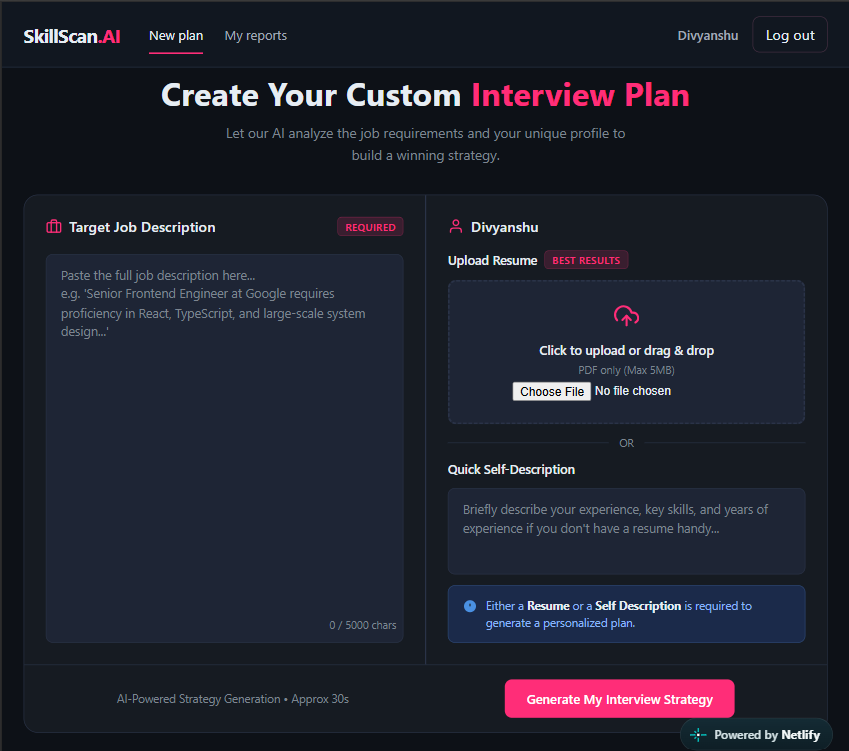
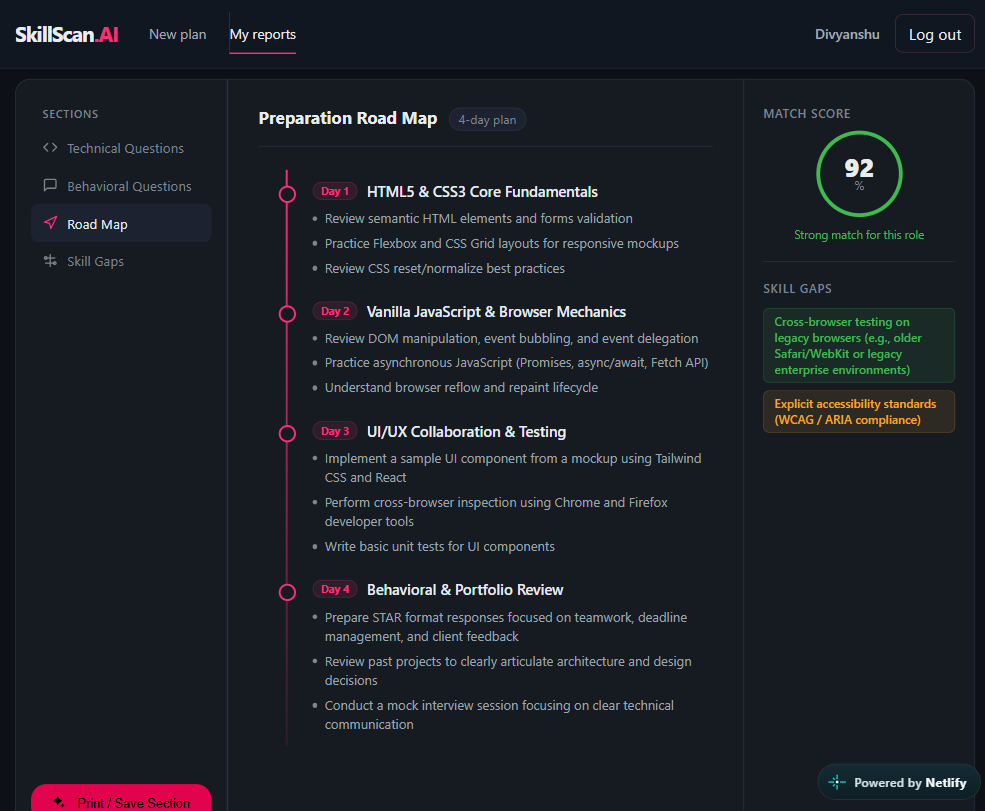

<div align="center">

# SkillScan.AI

### Your AI-powered interview preparation assistant

Turn a job description and your experience into a focused, personalized interview preparation plan.

[](https://d-skill-scan-ai.netlify.app/)
[](https://skillscan-ai-n3ii.onrender.com)
[](https://github.com/DivyanshuSahu2000/SkillScan.AI)


</div>

---

## ✨ About

**SkillScan.AI** is a full-stack interview preparation app that compares your
profile with a target job description. Upload a text-based PDF resume, write a
self-description, or provide both. The app uses Google Gemini to generate a
personalized report to help you prepare with focus.

## 🚀 Live links

| Resource | Link |
| --- | --- |
| Web application | [d-skill-scan-ai.netlify.app](https://d-skill-scan-ai.netlify.app/) |
| Backend API | [skillscan-ai-n3ii.onrender.com](https://skillscan-ai-n3ii.onrender.com) |
| Source code | [GitHub repository](https://github.com/DivyanshuSahu2000/SkillScan.AI) |
| Developer portfolio | [Divyanshu Sahu](https://divyanshu-sahu.netlify.app/) |

## 📸 Preview

### Create an interview plan

Add a job description and your resume or self-description to generate a
personalized preparation plan.



### Review your interview report

Explore the match score, skill gaps, interview questions, and preparation
roadmap in one report.



## 🌟 Features

| Feature | What you can do |
| --- | --- |
| 🎯 Profile match score | See an AI-generated assessment of how your profile aligns with the role. |
| 🧠 Technical questions | Practice role-relevant questions with interviewer intent and example answers. |
| 💬 Behavioral questions | Prepare for behavioral interviews with suggested questions and answers. |
| 🔎 Skill-gap analysis | Identify skills to focus on before the interview. |
| 🗺️ Preparation roadmap | Follow a day-by-day preparation plan. |
| 📂 Saved reports | Sign in to revisit your previous interview plans. |
| 📄 Flexible profile input | Use a text-based PDF resume, a self-description, or both. |
| 🖨️ Print-friendly reports | Print or save report sections using your browser. |

## 🧭 How it works

```text
Job description + resume or self-description
                     ↓
          SkillScan.AI backend
                     ↓
      Google Gemini generates a report
                     ↓
 Match score · Questions · Skill gaps · Roadmap
```

1. Register or sign in.
2. Paste the target job description.
3. Upload a text-based PDF resume, enter a self-description, or provide both.
4. Generate your report and review the preparation recommendations.

## 🛠️ Tech stack

| Area | Technologies |
| --- | --- |
| Frontend | React, Vite, React Router, Sass, Axios |
| Backend | Node.js, Express |
| Database | MongoDB, Mongoose |
| AI | Google Gemini, Google GenAI SDK |
| Authentication | JWT in an HTTP-only cookie |
| Deployment | Netlify (frontend), Render (backend) |

## 🏗️ Architecture

| Component | Responsibility |
| --- | --- |
| React frontend | User interface, authentication, resume upload, and report presentation |
| Express API | Authentication, report generation, and report retrieval |
| MongoDB | User data and saved interview reports |
| Google Gemini | Interview questions and personalized preparation recommendations |
| HTTP-only cookie | Authentication token handling |

## ⚡ Run locally

### Prerequisites

- [Node.js 20.19 or newer](https://nodejs.org/)
- npm
- A MongoDB database
- A [Google Gemini API key](https://aistudio.google.com/app/apikey)

### 1. Clone the repository

```bash
git clone https://github.com/DivyanshuSahu2000/SkillScan.AI.git
cd SkillScan.AI
```

### 2. Configure the backend

Create `Backend/.env`:

```env
MONGO_URI=your_mongodb_connection_string
JWT_SECRET=replace_with_a_long_random_secret
SKILLSCAN_GENAI_API_KEY=your_google_gemini_api_key

# Optional: defaults to 3000
PORT=3000

# Optional: defaults to http://localhost:5173
CLIENT_URL=http://localhost:5173
```

Use your own values. Keep credentials private and do not commit environment
files containing real secrets.

### 3. Install and start the backend

```bash
cd Backend
npm install
npm run dev
```

The backend listens on port `3000` by default.

### 4. Install and start the frontend

Open a second terminal from the repository root:

```bash
cd Frontend
npm install
npm run dev
```

Vite normally serves the frontend at [http://localhost:5173](http://localhost:5173).
The frontend uses `http://localhost:3000` as its default API URL. To use a
different backend URL, create `Frontend/.env.local`:

```env
VITE_API_URL=http://localhost:3000
```

If the frontend uses a different origin, set the backend's `CLIENT_URL` to
match it.

## 🔌 API reference

| Method | Endpoint | Description |
| --- | --- | --- |
| `POST` | `/api/auth/register` | Register a new account |
| `POST` | `/api/auth/login` | Sign in |
| `GET` | `/api/auth/logout` | Sign out |
| `GET` | `/api/auth/get-me` | Retrieve the current user's details |
| `POST` | `/api/interview/` | Generate an interview preparation report |
| `GET` | `/api/interview/` | List the signed-in user's saved reports |
| `GET` | `/api/interview/report/:interviewID` | Retrieve one saved report |

The report-generation endpoint accepts `multipart/form-data`:

| Field | Description |
| --- | --- |
| `jobDescription` | Required target job description |
| `selfDescription` | Optional candidate self-description |
| `resume` | Optional PDF resume, maximum 5 MB |

Provide a resume, a self-description, or both. The interview endpoints and
`/api/auth/get-me` require authentication. The frontend sends credentials so
the HTTP-only authentication cookie can be used.

## ✅ Development checks

Run commands from the relevant project directory:

```bash
# Backend tests
cd Backend
npm test
```

```bash
# Frontend lint
cd Frontend
npm run lint
```

```bash
# Frontend production build
cd Frontend
npm run build
```

## 🗺️ Roadmap

- **Planned:** AI-assisted resume builder that tailors the presentation of a
  candidate's genuine skills and experience to a target job.
- Resume regeneration for different job descriptions.
- Expanded report export options.
- Preparation progress tracking.

These are future ideas, not current features.

## 🤖 Responsible AI

SkillScan.AI provides AI-generated guidance for interview preparation. Match
scores, questions, and recommendations are estimates—not definitive judgments
of a candidate's abilities or hiring prospects. Review generated content and
adapt it to your real experience.

## 👨‍💻 Author

**Divyanshu Sahu**

[](https://divyanshu-sahu.netlify.app/)
[](https://github.com/DivyanshuSahu2000)

<div align="center">

---

*Built with ❤️ to make interview preparation more personalized and actionable.*

</div>
